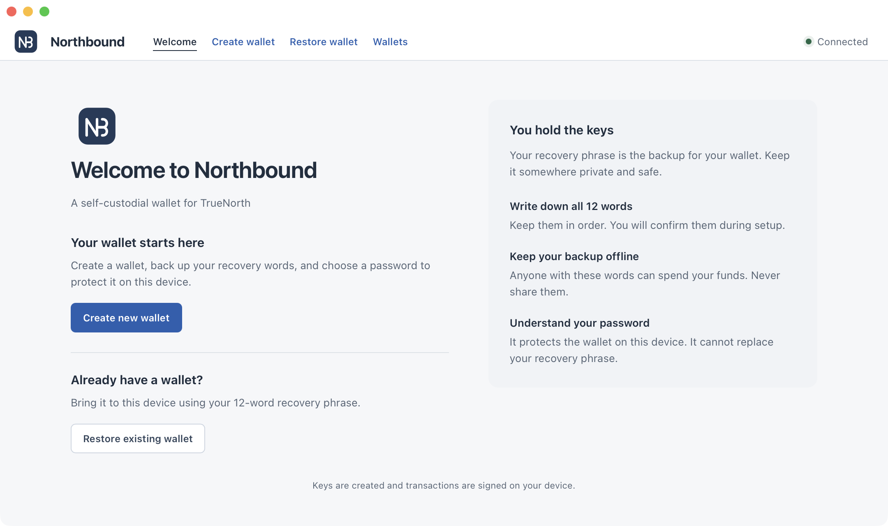

[](https://northboundwallet.org)

<p align="center">
  <a href="https://northboundwallet.org">Website</a> ·
  <a href="https://github.com/nova9/northbound/releases">Downloads</a> ·
  <a href="#local-development">Getting started</a> ·
  <a href="SECURITY.md">Security</a> ·
  <a href="ROADMAP.md">Roadmap</a>
</p>

<p align="center">
  <a href="#donate"></a>
</p>

Northbound is a self-custodial lightweight desktop wallet for
[TrueNorth](https://github.com/truenorth-project/truenorth).

The desktop application is built with Rust and Dioxus. It creates addresses,
stores encrypted wallet secrets, and signs transactions on the user's device.
A separate Rust and Axum API reads public blockchain data from `truenorthd` and
broadcasts transactions that have already been signed by the wallet.

> Northbound is an independent community project, not an official TrueNorth
> wallet. It has not received an independent security
> audit. Do not use it with significant funds.

<p align="center">
  
</p>

## Current capabilities

- Create or restore a wallet with 12 recovery words.
- Keep multiple named wallets on one device, each with its own password.
- Encrypt the local wallet file with Argon2id and XChaCha20-Poly1305.
- Derive native TrueNorth P2QRH receiving and change addresses locally.
- Display balances and transaction history supplied by the wallet server.
- Construct and review the recipient, amount, and fee before signing.
- Sign P2QRH transactions locally and broadcast the signed transaction.
- Change the local wallet password without changing the recovery phrase.

## Security and server trust

Recovery words, private keys, passwords, and transaction signing remain in the
desktop wallet. They are never sent to the Northbound server.

The current version relies on its configured server for address activity,
UTXOs, transaction history, fee estimates, chain height, transaction status,
validation, and broadcasting. A dishonest or unavailable server cannot sign a
transaction, but it can hide or delay blockchain information, provide
misleading history, suggest a poor fee, or refuse to broadcast.

See [SECURITY.md](SECURITY.md) for the current security boundary and
[ROADMAP.md](ROADMAP.md) for the planned move toward Electrum-style local
verification.

## Public server

An independent community server for **TrueNorth mainnet** is available at
[https://northbound.tncoin.xyz](https://northbound.tncoin.xyz), operated by
[Ironfist-2000](https://github.com/Ironfist-2000).
See the [server announcement](https://github.com/nova9/northbound/issues/2#issuecomment-6887701339)
for details.

To connect, open **Security → Server** in the wallet, enter
`https://northbound.tncoin.xyz` as the **Server URL**, and save.
The [server trust considerations](#security-and-server-trust) above apply to
this server as well.

## Repository structure

| Directory | Purpose |
| --- | --- |
| [wallet/](wallet/) | Dioxus desktop wallet and local signing |
| [server/](server/) | Axum API backed by `truenorthd` |
| [shared/](shared/) | JSON request and response types |
| [indexer/](indexer/) | SQLite chain index, pending snapshots, and wallet queries |
| [truenorth-rpc/](truenorth-rpc/) | Shared daemon RPC transport and decoding |
| [scripts/](scripts/) | Local development and packaging helpers |

## Local development

Use **Wallets** in the header to create, restore, switch, or remove wallets.
Switching locks the current wallet. **Open wallet folder** opens the storage
folder in Finder, Windows Explorer, or the Linux file manager.

Each wallet is an encrypted `<name>.json` file. Development wallets live in
`.local/wallets/<network>/`; release wallets use the operating system's local
data folder under `io.github.nova9.northbound/wallets/<network>/`.
The previous single `wallet.json` is not imported automatically; restore that
wallet with its recovery words. Removing a wallet permanently deletes its local
file after a backup confirmation and an exact name check. It does not move funds
or remove other copies of the file.

Install a Rust toolchain, then download a TrueNorth release and start a local
regtest node:

```bash
./scripts/download-truenorth.sh
./scripts/regtest.sh start
```

Create and fund the development wallet, send coins, or stop the node:

```bash
./scripts/regtest.sh create-wallet funding
./scripts/regtest.sh get-address funding
./scripts/regtest.sh generate-coins funding 101
./scripts/regtest.sh send-coins funding <receiving-address> [amount]
./scripts/regtest.sh stop
```

Mining takes a Core wallet name and defaults to 101 blocks; sending
defaults to 10 NORTH. `get-address` generates a fresh receiving address for the
named wallet. Address, mining, and sending commands automatically load an
existing wallet when needed. Development
commands share the persistent data directory `.local/truenorth/`.

For a local mainnet node, use `./scripts/mainnet.sh start` and
`./scripts/mainnet.sh stop`. Use `./scripts/mainnet.sh tip` to display the current
height, best block hash, and synchronization status. Use `./scripts/mainnet.sh peers`
for the connected peer count. Use `./scripts/mainnet.sh presync` to read the latest
logged header pre-sync, header re-download, or block-tip progress for the latest
startup, plus the highest peer-advertised height logged during that startup.
Peer heights are reported claims, not verified network tips. The output includes
timestamps; a stopped node's output may be stale.
This helps while RPC reports height zero during header pre-sync.
The script runs an unpruned node with RPC on loopback,
using `.local/truenorth/mainnet/` for mainnet data and `.local/truenorth/mainnet/.cookie` for RPC
authentication. Regtest data remains in its `regtest/` subdirectory. Initial
mainnet synchronization downloads the chain and requires disk space for it.
Run the API with a separate mainnet index:

```bash
TRUENORTH_NETWORK=main \
TRUENORTH_INDEX_DATABASE=.local/indexer/mainnet.sqlite \
  cargo run -p server --release
```

Run the server and wallet in separate terminals:

```bash
cargo run -p server
cargo run -p wallet
```

Run the automated tests:

```bash
cargo test --workspace
```

Run the P2QRH checks against an isolated TrueNorth Core regtest node:

```bash
./scripts/test-truenorth-integration.sh
```

Development downloads and integration tests use the Core release pinned in
[`TRUENORTH_VERSION`](TRUENORTH_VERSION). All local regtest scripts use the shared
binaries in `.local/truenorth-bin/<version>/<platform>/`. The integration script
calls the downloader, reuses cached releases, and removes its temporary chain
on exit. Downloads are verified against the release's SHA-256 checksum.

To download another release without changing the project's selected version:

```bash
./scripts/download-truenorth.sh 30.5.2
```

Versions with a `v` prefix are also accepted. Update `TRUENORTH_VERSION` to select
which release the development and integration scripts use. NixOS deployment
versions in [`server/devops/app.nix`](server/devops/app.nix) are managed independently.
See [test conventions and commands](TESTING.md) for the shared unit-test layout
and isolated wallet, indexer, and server regtest suites.

The [server](server/README.md) starts the [SQLite indexer](indexer/README.md),
follows reorganizations, and serves wallet data through indexed queries. It uses
`.local/indexer/chain.sqlite` by default; set `TRUENORTH_INDEX_DATABASE` to change
the path. Stop any standalone indexer writing that file before running the server.
`GET /ready` reports catch-up and freshness; wallet data returns a retryable error
until confirmed and pending snapshots are ready. Fee estimation, validation, and
broadcast remain connected directly to the daemon.

Run the complete indexed API checks with an isolated node:

```sh
./scripts/test-truenorth-integration.sh server
```

## Building and releases

Build the mainnet desktop wallet for the host OS:

```bash
./scripts/build-wallet.sh        # Linux AppImage or macOS app
./scripts/build-windows.ps1      # Windows MSI, run in PowerShell
```

Publishing a GitHub release, including a pre-release such as `v0.1.0-rc.1`,
runs the macOS, Windows, and Linux release workflows. Commit the workflows before creating
the tag. They build the mainnet wallet and attach these files with SHA-256
checksums to the release:

- `Northbound-<tag>-macos-arm64.zip`: ad-hoc signed Apple Silicon app.
- `Northbound-<tag>-windows-x64.msi`: Windows x64 installer.
- `Northbound-<tag>-linux-x64.AppImage`: Linux x64 application.

Draft releases do not trigger builds. To build without publishing a release,
select **macOS release build**, **Windows release build**, or **Linux release build**
in **Actions**, then choose **Run workflow**;
download the files from that run's artifacts. Manual builds use
`dev-<short-commit>` in the filename.
macOS builds do not yet have an Apple Developer ID
signature or notarization.

Linux builds use Ubuntu 24.04. The workflow installs GTK/WebKitGTK dependencies
and checks that the packaged AppImage opens a window under Xvfb before uploading
it. This launch check does not replace testing wallet operations on a Linux desktop.
For local Ubuntu 24.04 builds, install the same packages listed in
[the Linux workflow](.github/workflows/release-linux.yml), Rust with the
`llvm-tools-preview` component, and Dioxus CLI 0.7.10, then run
`./scripts/build-wallet.sh`.

To launch a downloaded Linux package:

```sh
chmod +x Northbound-<tag>-linux-x64.AppImage
./Northbound-<tag>-linux-x64.AppImage
```

If FUSE is unavailable, run it with `APPIMAGE_EXTRACT_AND_RUN=1`.

Mainnet builds use the local server by default. Set the server URL explicitly
when building a wallet that should connect to a hosted server:

```bash
NORTHBOUND_API_BASE_URL="https://wallet-api.example.com" \
  cargo build -p wallet --release --no-default-features --features mainnet
```

## Server deployment

Server deployment uses NixOS. The configuration in
[`server/devops/app.nix`](server/devops/app.nix) builds the server and installs
TrueNorth Core, runs both as systemd services, and configures Caddy for HTTPS.
The chain and index persist in `/var/lib/truenorth` and `/var/lib/northbound`.

Before importing the module into a NixOS host configuration, select the server
source revision, replace the placeholder source and Cargo hashes, and adjust
the domain, IP address, and host settings. Keep the daemon RPC on loopback;
the server reads its local authentication cookie.

## Project status

Northbound is under active development. Before a general release, the project
still needs broader TrueNorth regtest coverage, Linux desktop testing,
signed release artifacts, independent review, and a clearly documented public
server deployment.

Bug reports and technical review are welcome. Please report security problems
privately and never include recovery words, private keys, passwords, or live
RPC credentials.

## Donate

Enjoy using Northbound? You can support the project with an optional NORTH donation.

Send **NORTH** to:

```text
north1z5h0t57p3tg2dzgtnfjy45skkttmrw00uygajdcq092ctnpjy5dkstw30q8
```

Copy the address into your wallet, choose an amount, and review the recipient,
amount, and network fee before signing. Thank you for supporting Northbound!

## License

Northbound is available under the [MIT License](LICENSE), the same license used
by TrueNorth Core.
